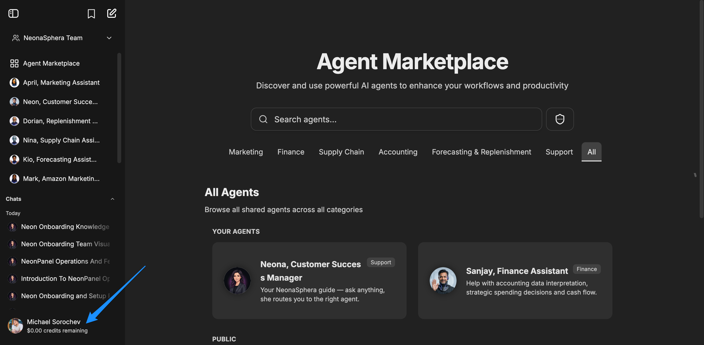
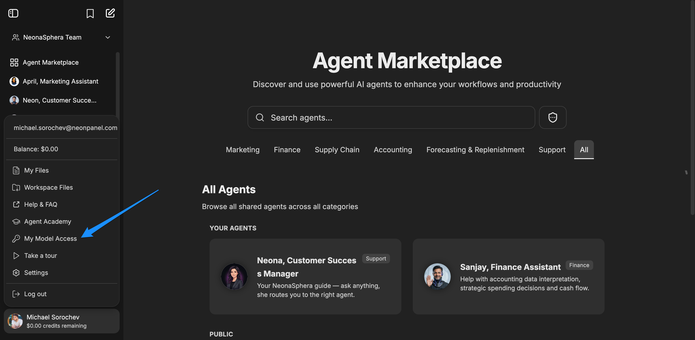
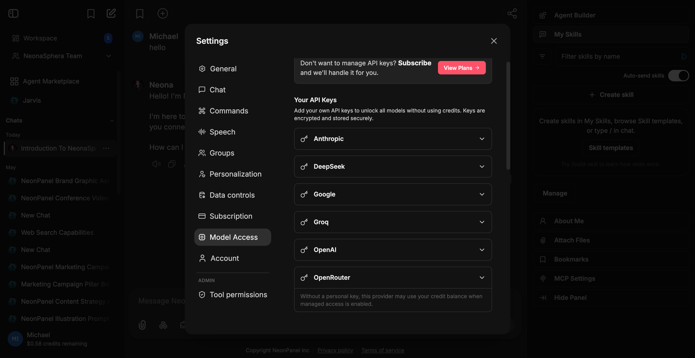

# How to add your API keys to NeonaSphera

Category: How-To · Article 1555 · Updated 2026-06-29

Helping customers set their API keys

## Overview

1. From any page in the platform, click your avatar in the bottom left corner: 
2. In the menu that opens, click: My Model Access -- 
3. In the next menu, chose a provider with whom you have API keys, and set the key there 
4. Or shown in the image above, users could choose Managed Access, and pay for tokens via NeonaSphera, and we will pass the tokens on to our model provider (OpenRouter) 'at cost', meaning we won't take any markup on the requests.
