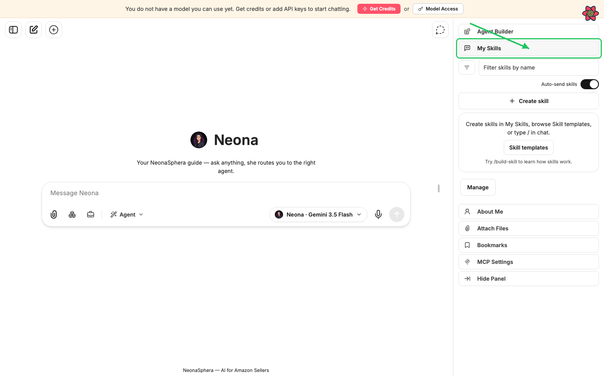
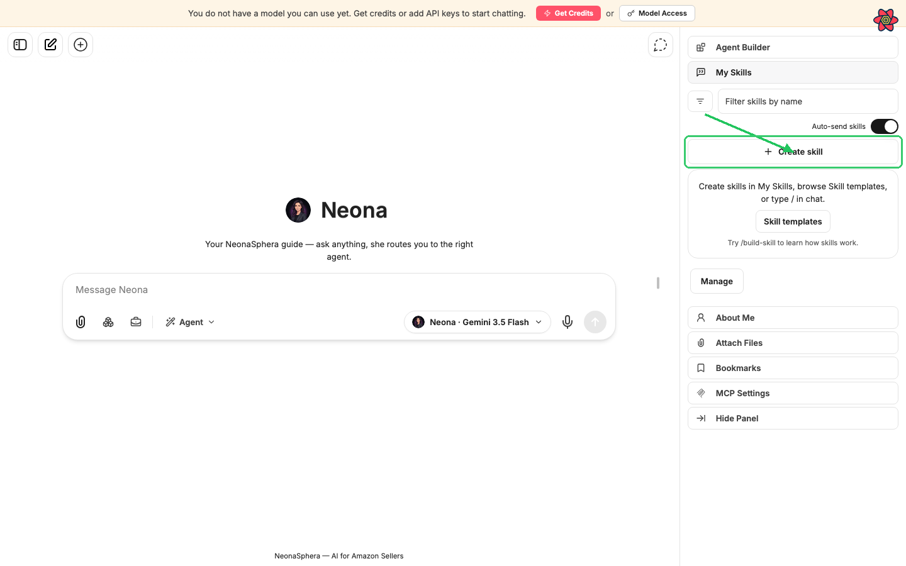
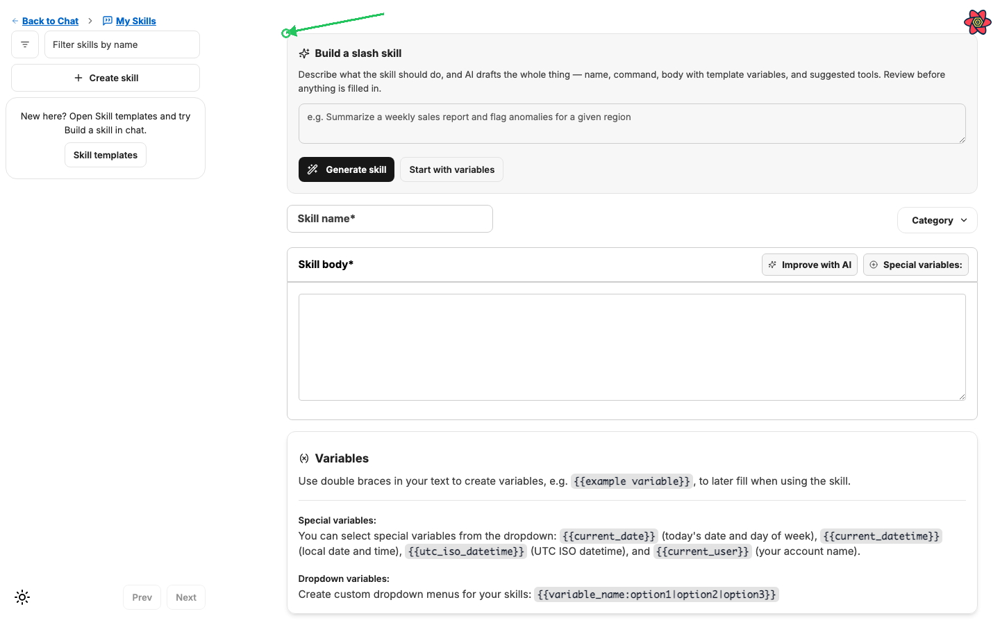
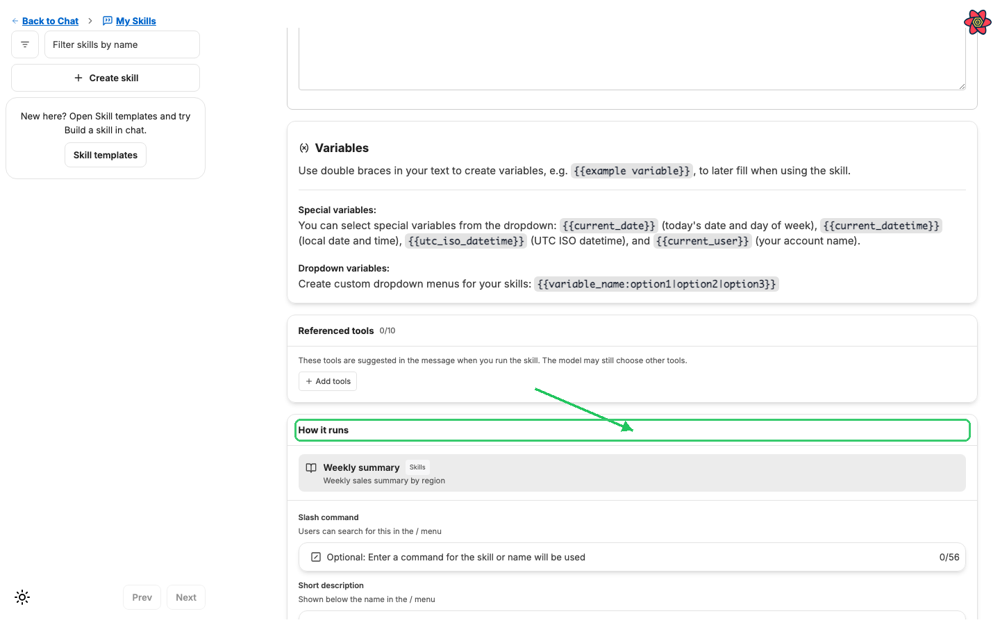
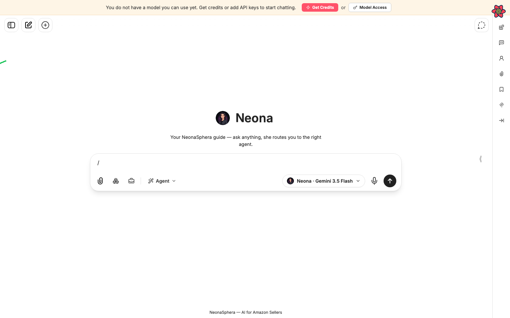
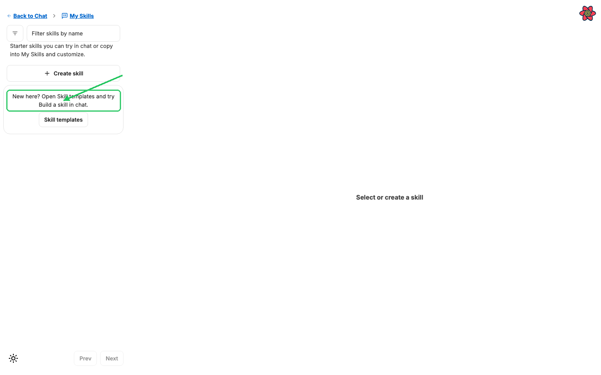
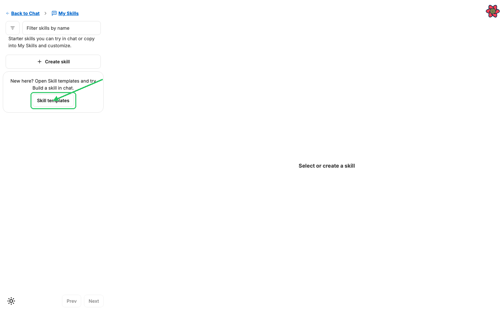

# How to create and use skills (My Skills)

Category: NeonaSphera Product · Article 9001 · Updated 2026-07-05

**My Skills** are reusable slash commands you build once and run in any chat. Each skill can include a prompt body, optional `{{variables}}`, and suggested tools. When you pick a skill from the **`/`** menu (or from the **My Skills** panel), NeonaSphera fills in your inputs and s

## Overview

**My Skills** are reusable slash commands you build once and run in any chat. Each skill can include a prompt body, optional `{{variables}}`, and suggested tools. When you pick a skill from the **`/`** menu (or from the **My Skills** panel), NeonaSphera fills in your inputs and sends the finished prompt to the agent.

## Step-by-step

### Open My Skills

1. Open any chat.
2. In the **right panel**, click **My Skills** (speech-bubble / quote icon in the side navigation).

3. The **My Skills** panel shows:
   - **Create skill**
   - Your skill list (or an empty-state hint)
   - A filter for **All**, **Your skills**, **Skill templates**, and **Shared in workspace**
   - The **Auto-send skills** toggle
   - **Manage** (opens the full **My Skills** editor)

### Create a skill

4. Click **Create skill** in the panel (or type **`/`** in the message box and choose **Create skill** under **Commands**).
5. You land on the **New skill** form.

6. **Optional — draft with AI.** In **Build a slash skill**, describe what the skill should do (for example: *Summarize a weekly sales report and flag anomalies for a given region*), then click **Generate skill**. Review the suggested name, command, body, and tools. Click **Use this draft** to fill the form, or reply with a note to refine the draft. Prefer a blank starter? Click **Start with variables** to load a reusable template with `{{goal}}`, `{{context}}`, and `{{output_format}}`.
7. Fill in the required fields:
   - **Skill name**\* — the display name in lists and the **`/`** menu
   - **Skill body**\* — the full prompt the agent receives (use `{{variable_name}}` for fill-in fields)
8. Under **How it runs**:
   - **Slash command** — the short name users type after **`/`** (for example `weekly-summary`). Skills only appear in the **`/`** menu when this is set.
   - **Short description** — one line shown under the name in the **`/`** menu

9. **Optional:** under **Referenced tools**, pick tools the skill should suggest when it runs. The model may still use other tools.
10. Click **Create skill** to save. You are taken to the skill’s editor page.

### Use a skill in chat

11. In the message box, type **`/`**.
12. Search under **Skills**, then select your skill (or click the skill card in the **My Skills** panel).

13. **If the skill has variables**, an **Inputs** form opens. Fill the fields (they are optional unless you need them), check the **Preview**, then click **Submit**.

14. **What happens next depends on Auto-send skills:**
    - **Auto-send skills** on — the skill runs immediately.
    - **Auto-send skills** off — a skill chip appears above the message box (for example `/weekly-summary`). Type an optional note if you want, then send the message as usual. Click the chip’s **×** (**Remove skill**) to cancel.

### Start from a Skill template

15. In the **My Skills** panel (or full editor), open the filter and choose **Skill templates**.
16. Starter skills appear with **Try in chat** and **Add to My Skills**.

17. Click **Try in chat** to run the template once without copying it.
18. Click **Add to My Skills** to copy it into your library. In the dialog, set **Skill name** and **Slash command**, then confirm with **Add to My Skills**.

19. New here? Open **Skill templates** and try **Build a skill** in chat (`/build-skill`) — it walks you through how skills work, then you can add your own copy and customize it.

### Manage and edit skills

20. In the chat **My Skills** panel footer, click **Manage** to open the full **My Skills** page.
21. Select a skill to edit its **Skill name**, **Skill body**, **Slash command**, **Short description**, tools, and versions. Use **Back to My Skills** to return to the list.

## Tips

- **My Skills** (slash skills you create) are different from **agent skills** built into an agent. My Skills are ones you invoke with **`/`**.
- Without a **Slash command**, a skill still exists in your library but will not show under **`/`**.
- Use `{{variable}}` in the **Skill body** so one skill works for many situations. Dropdown options use `{{tone:formal|casual|business}}`.
- Turn **Auto-send skills** off when you want to review or add a note before the skill runs.
- Empty library? The panel points you to **Skill templates** and **Try /build-skill to learn how skills work.**

## Frequently Asked Questions

**Where do I find My Skills?**
In any chat, open the right panel and click **My Skills**. For the full editor, click **Manage** in that panel.

**How do I run a skill quickly?**
Type **`/`** in the message box, search under **Skills**, and select it. You can also click the skill card in the **My Skills** panel.

**Why doesn’t my skill appear in the `/` menu?**
Add a **Slash command** under **How it runs**, then save. Only skills with a command are listed under **Skills** in the palette.

**Can I customize a template without changing the original?**
Yes. Use **Add to My Skills** on a **Skill templates** card. You get your own copy with a name and command you choose.

**What are Referenced tools?**
They are tools suggested when the skill runs. The agent may still choose other tools if needed.
