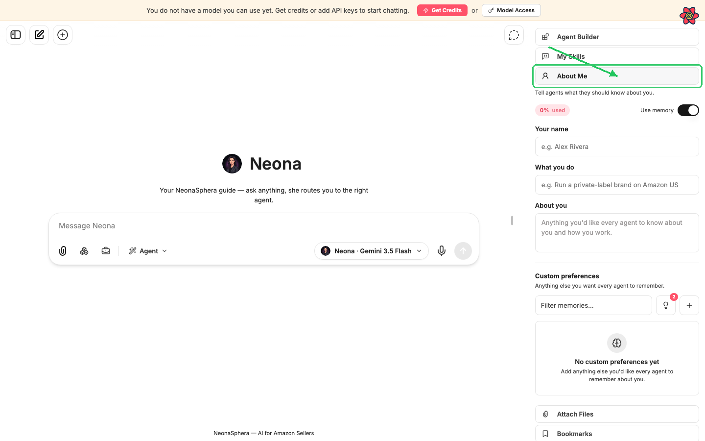
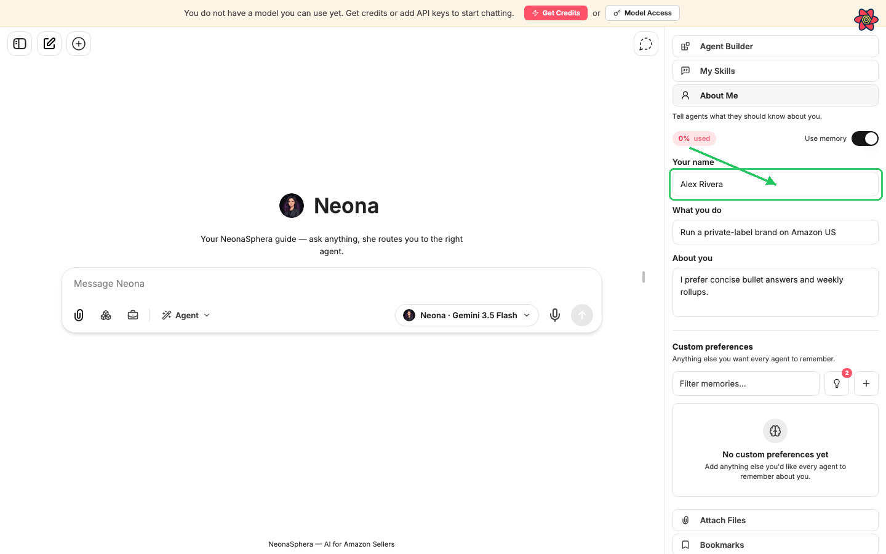
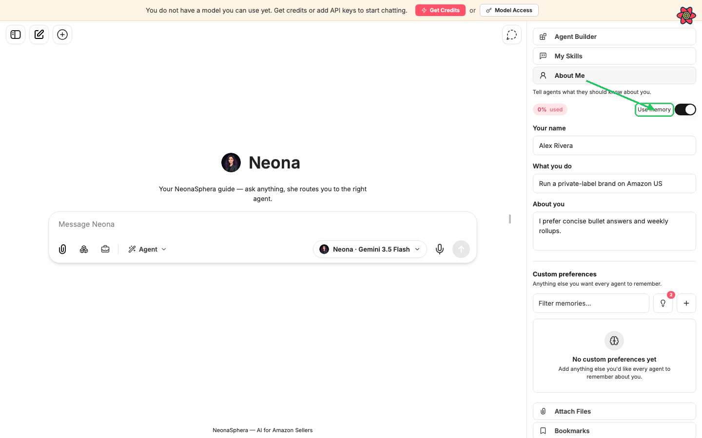
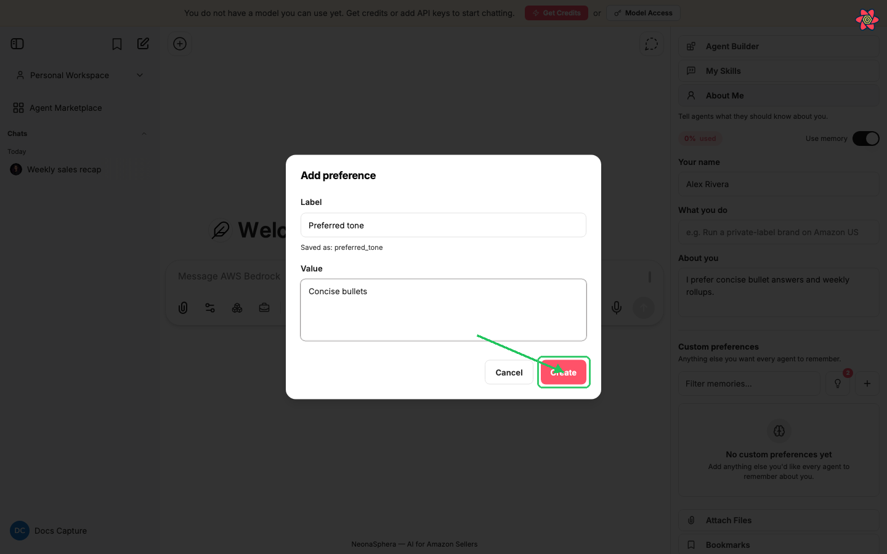
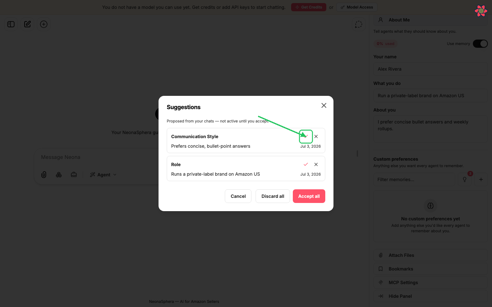
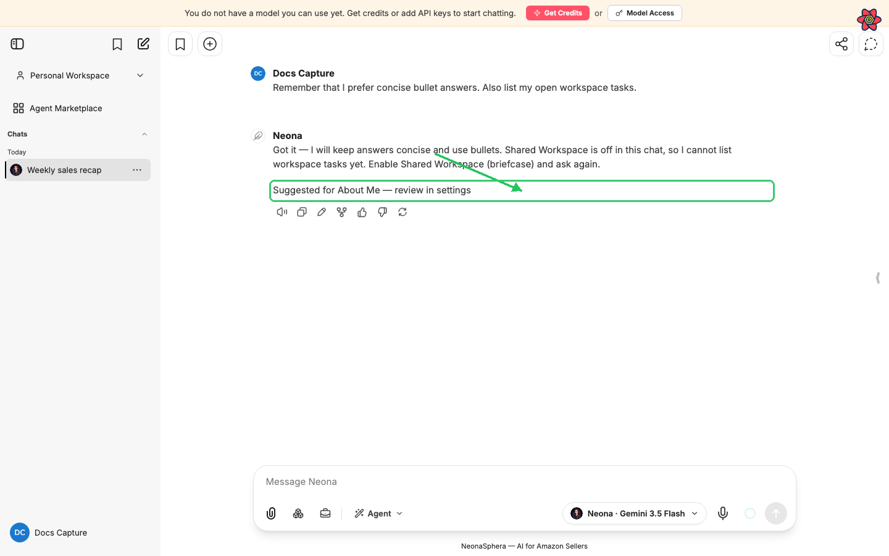

# How to tell agents about me (About Me)

Category: NeonaSphera Product · Article 9002 · Updated 2026-07-05

**About Me** is your personal profile for NeonaSphera agents. Fill in who you are, what you do, and any preferences you want every agent to remember. Agents use these facts only when **Use memory** is on. Suggestions from chat are never applied until you accept them.
** Pending —

## Overview

**About Me** is your personal profile for NeonaSphera agents. Fill in who you are, what you do, and any preferences you want every agent to remember. Agents use these facts only when **Use memory** is on. Suggestions from chat are never applied until you accept them.
** Pending — capture was blocked by the login screen at `https://my.neonasphera.com`. Steps and labels below match the live product UI. Replace the placeholder images under `assets/tell-agents-about-me/` after a logged-in capture pass.

## Step-by-step

### Open About Me

1. Sign in to NeonaSphera and open any chat.
2. On the **right-hand panel**, click **About Me** (person icon). If the panel is collapsed, expand it first, then choose **About Me**.

You should see the subtitle *"Tell agents what they should know about you."*

### Fill in your profile

3. Enter **Your name** (for example, `Alex Rivera`).
4. Enter **What you do** (for example, `Run a private-label brand on Amazon US`).
5. Enter **About you** — anything you want every agent to know about you and how you work.

Each field **saves when you leave it** (click or tab away). Clearing a field removes that fact. There is no separate Save button for these profile fields.

### Turn memory on or off

6. At the top of **About Me**, find **Use memory**. Leave it **on** so agents can use your saved profile and preferences. Turn it **off** if you want agents to ignore saved facts for now (your entries stay stored; they just are not used in chat).

If a usage badge appears (for example, *"12% used"*), that is how much of your memory capacity is filled — not an error.

### Add custom preferences

Use **Custom preferences** for anything that does not fit the three profile fields (tone, markets, tools, constraints, and so on).

7. Under **Custom preferences**, click the **+** button (**Add preference**).
8. In the dialog:
   - **Label** — a short name (for example, `Preferred tone`). The app shows how it will be stored (for example, *"Saved as: preferred_tone"*).
   - **Value** — the detail agents should remember.
9. Click **Create**.

To change a preference later, use the pencil (**Edit Memory**) on its card. To remove it, use the trash control (**Delete Memory**) and confirm **Delete**.

You can filter the list with **Filter memories...** when you have many preferences.

### Review suggestions from chat

While you chat, NeonaSphera may propose facts for **About Me**. Suggestions are **not active** until you accept them.

10. In chat, look for **"Suggested for About Me — review in settings"** under a message. Click it to open **About Me** and the **Suggestions** dialog.
11. Or open **About Me** and click the lightbulb (**Review suggestions**) when a green count badge appears.
12. In **Suggestions**, read each proposal (*"Proposed from your chats — not active until you accept."*), then:
    - **Accept** (check) or **Discard** (X) one at a time, or
    - **Accept all** / **Discard all** at the bottom.

### Ask agents to remember something in chat

13. In any chat, you can also say something explicit, for example:
    - *"Remember that I prefer concise bullet answers."*
    - *"Forget my preferred tone."*

Explicit remember/forget requests update your saved preferences directly. Other personal details you mention casually may only become **suggestions** for you to review under **About Me**.

## Tips

- **About Me** is personal profile data. Team or project work belongs in **Shared Workspace**, not here.
- Do not use **Label** values that match the profile fields (**name**, **role**, or **about you**) — those are reserved; you will see *"That label is reserved for a profile field above."*
- Labels must include at least one letter. Prefer plain words (spaces are fine); the app stores them as lowercase with underscores.
- Suggestions never apply themselves. If you ignore them, agents will not use those facts.
- Turning **Use memory** off does not delete your profile; it only stops agents from using it until you turn it back on.

## Frequently Asked Questions

**Where is About Me?**
Right-hand panel → **About Me** (person icon). It is not under the avatar **Settings** menu.

**Do I need to click Save?**
No for **Your name**, **What you do**, and **About you** — they save when you leave the field. Custom preferences save when you click **Create** (or save from edit).

**Will agents update About Me on their own?**
No. Agents do not write your profile. A background process may propose **suggestions**; only you accept or discard them. Explicit *"Remember that…"* / *"Forget…"* requests are the exception for direct updates.

**What is the difference between profile fields and custom preferences?**
Profile fields are the three guided inputs (**Your name**, **What you do**, **About you**). **Custom preferences** are any extra labeled facts you add yourself.

**Why do I see "Suggested for About Me — review in settings"?**
The system noticed something personal in chat and proposed it. Click the link (or the lightbulb in **About Me**) and **Accept** or **Discard**. Until you accept, agents do not use that suggestion.
