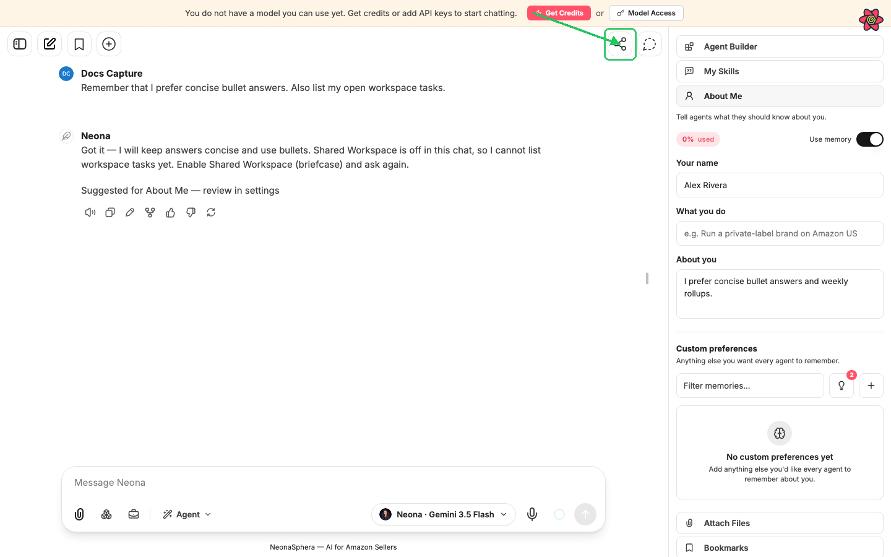
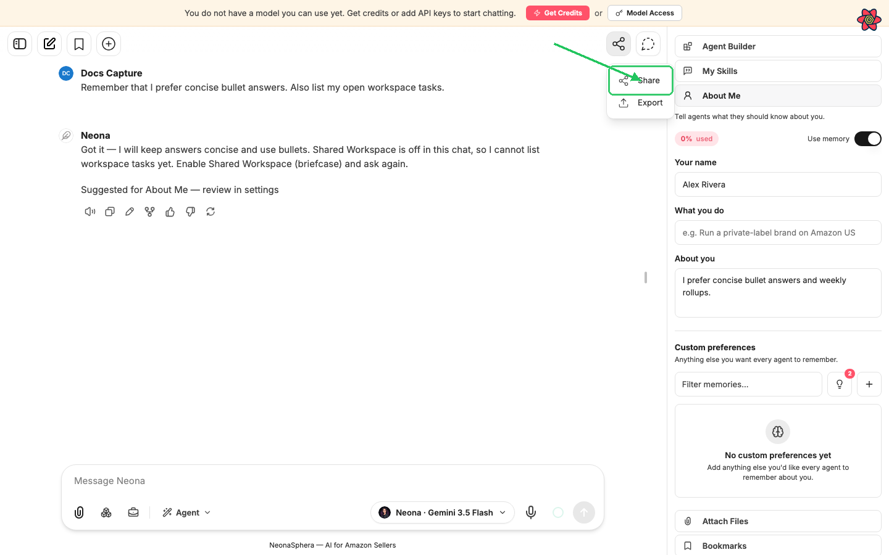
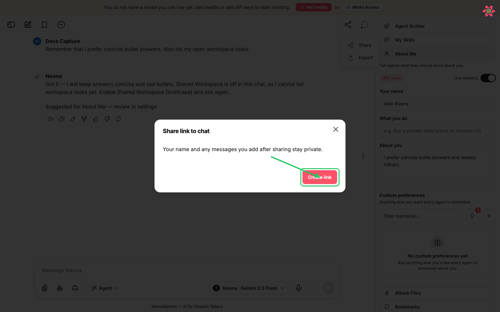
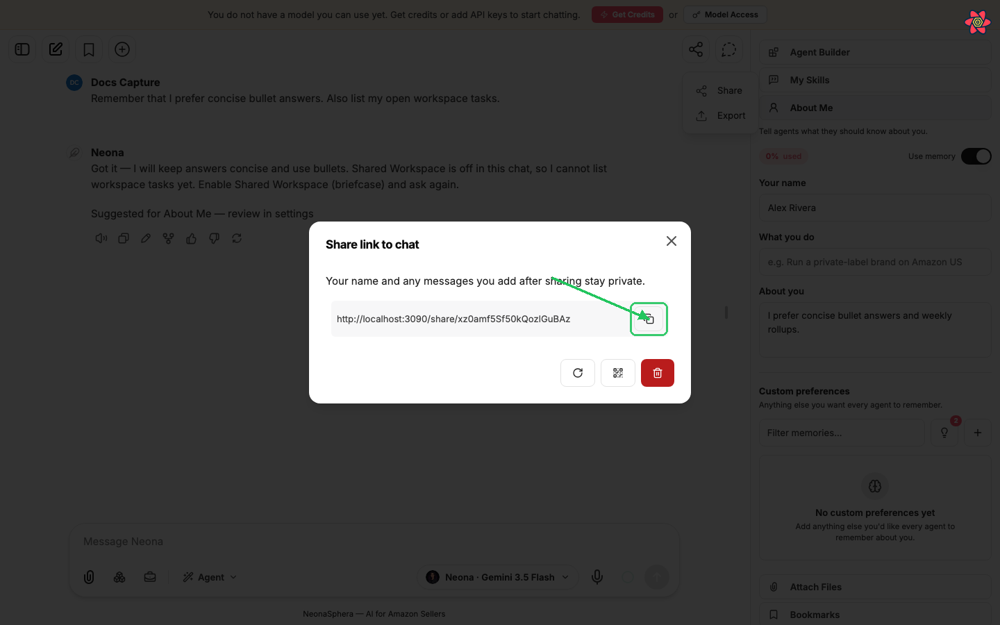
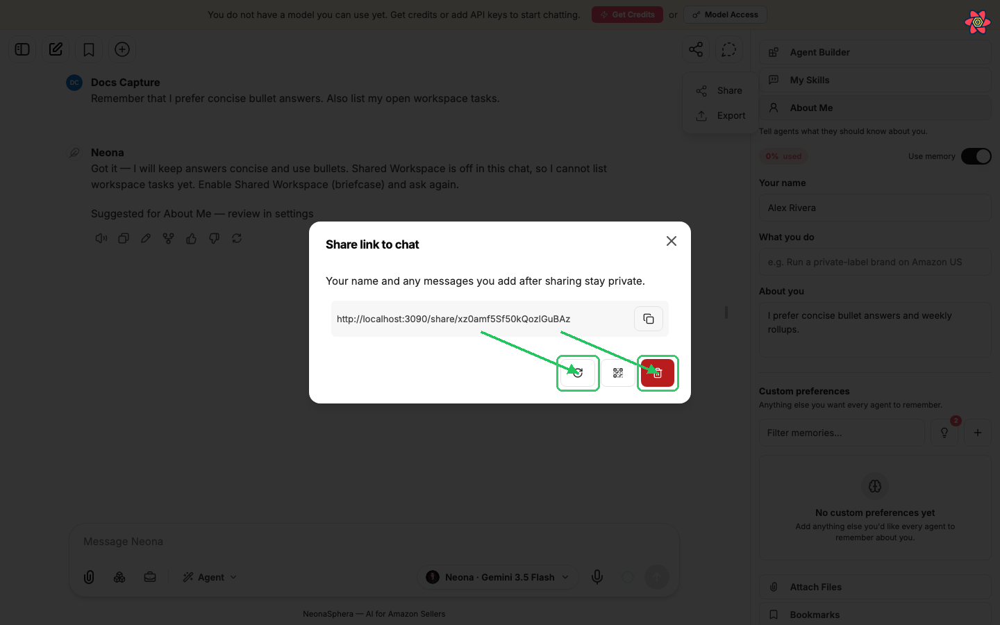
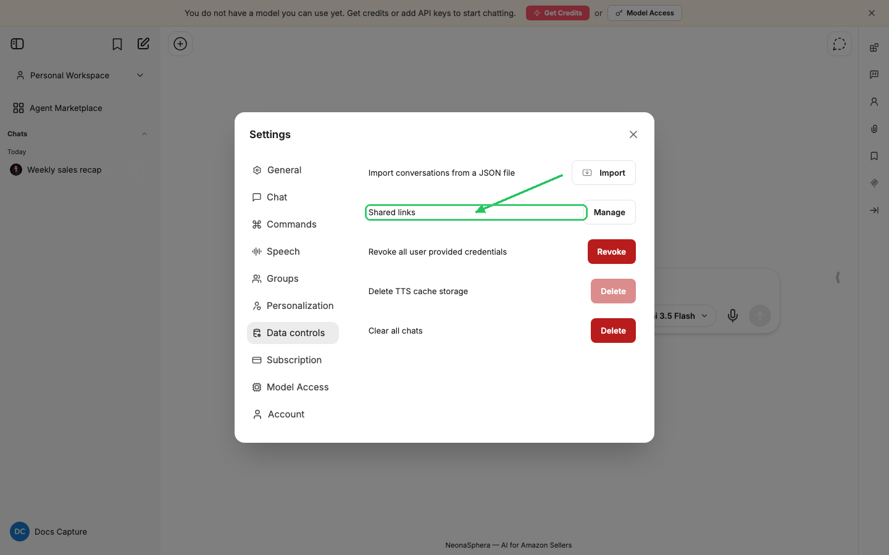

# How to share my chat with others

Category: NeonaSphera Product · Article 9004 · Updated 2026-07-05

You can share a read-only link to a conversation so anyone with the link can view the messages that were in the chat when you shared it. Recipients do not need a NeonaSphera account to open the link.

## Overview

You can share a read-only link to a conversation so anyone with the link can view the messages that were in the chat when you shared it. Recipients do not need a NeonaSphera account to open the link.

## Step-by-step

1. Open the conversation you want to share. It must already have at least one message — empty chats cannot be shared.

2. In the left sidebar, hover the chat title and click the **⋯** (conversation menu) button.

3. Click **Share**.

   You can also share from the open chat: click the **Export/Share** button (share icon) in the top-right of the chat header, then choose **Share**.

4. In the **Share link to chat** dialog, read the privacy note: *"Your name and any messages you add after sharing stay private."* Then click **Create link**.

5. Copy the link that appears (use the **Copy link** button next to the URL). Send that link to anyone you want to view the chat.

Anyone who opens the link sees a read-only page with the conversation title and the messages that were included when the link was created (or last refreshed). They cannot continue the chat as you.

## Update, QR code, or stop sharing

After a link exists, open **Share** again on the same chat. The dialog now says: *"Your name, custom instructions, and any messages you add after sharing stay private."*

- **Refresh link** — updates the shared snapshot to include messages added since you last shared, and issues a **new** URL. The old link stops working.
- **Show QR Code** / **Hide QR Code** — toggles a QR code for the current link (handy for phones or in-person sharing).
- **Delete** — opens **Delete Shared Link**. Confirm with **Delete** to revoke access immediately. Cancel with **Cancel**.

## Manage all shared links

1. Open **Settings** (avatar menu, bottom-left of the sidebar).
2. Go to **Data controls**.
3. Next to **Shared links**, click **Manage**.
4. Review your links by **Name** and **Date**. Open a shared page from the title link, jump back to the source chat, or delete a link you no longer want public.

## Tips

- Sharing is a **snapshot**, not a live mirror. New messages stay private until you click **Refresh link** (which also changes the URL).
- Your **name** and **custom instructions** are never included on the shared page.
- Anyone with the link can view it — treat shared chats like public documents and avoid secrets you would not post elsewhere.
- If you see **"Shared link not found"**, the link was deleted, refreshed (old URL), or never existed.

## Frequently Asked Questions

**Do recipients need a NeonaSphera account?**
No. The shared page is public for anyone who has the link.

**Can people reply or edit my chat through the link?**
No. Shared chats are view-only.

**What if I keep chatting after I share?**
Messages you add after sharing stay private. Use **Refresh link** when you want the public page to include newer messages — and send people the new URL.

**How do I stop sharing?**
Open **Share** on that chat and click **Delete**, or remove the link under **Settings → Data controls → Shared links → Manage**.
