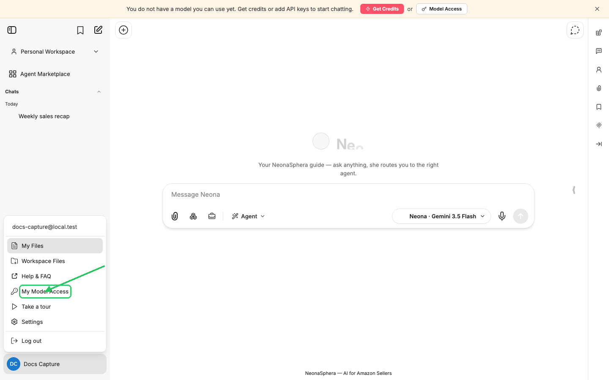
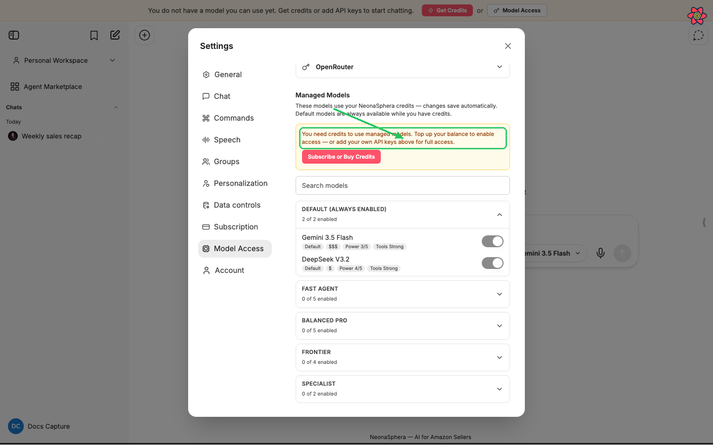
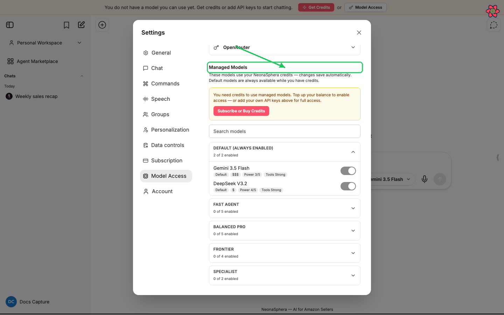
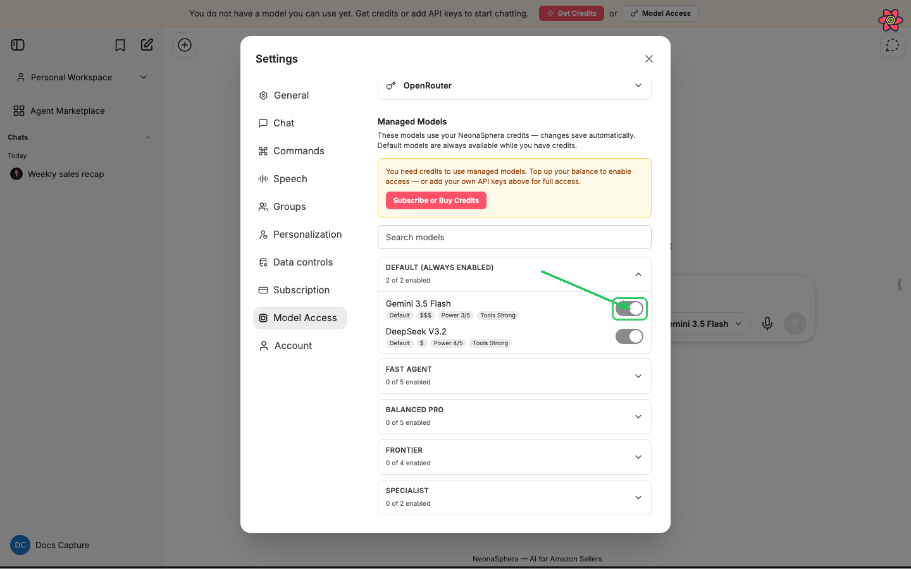
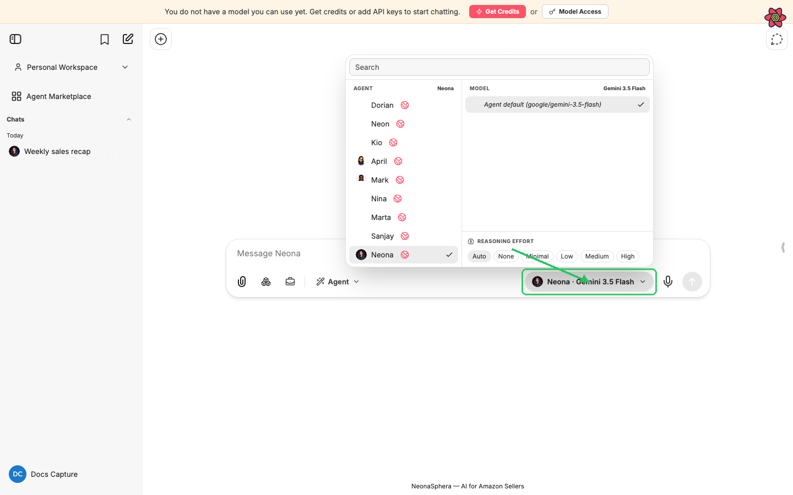

# How to enable more models

Category: NeonaSphera Product · Article 9005 · Updated 2026-07-05

NeonaSphera ships a small set of default models. You can turn on additional curated models so they appear in the chat model selector—using your credits, or your own OpenRouter key.

## Overview

NeonaSphera ships a small set of default models. You can turn on additional curated models so they appear in the chat model selector—using your credits, or your own OpenRouter key.

## Step-by-step

1. In the bottom-left of the sidebar, click your **avatar**.

2. Click **My Model Access**. This opens **Settings** on the **Model Access** tab.

   

   You can also open **Settings** (gear icon in the same menu), then choose the **Model Access** tab.

3. Confirm you can use managed models. You need **either**:
   - a credit balance with managed access (subscription, trial, or free sign-up credits), **or**
   - a personal **OpenRouter** key under **Your API Keys**.

   If toggles are locked, you’ll see: *"You need credits to use managed models. Top up your balance to enable access — or add your own API keys above for full access."* Click **Subscribe or Buy Credits** (or **Buy Credits** if you already subscribe), or add an OpenRouter key in **Your API Keys** first.

   

4. Scroll to **Managed Models**. The description explains that these models use your NeonaSphera credits and that changes save automatically. Default models stay available while you have credits.

   

5. Find the model you want:
   - Use **Search models** to filter by name, provider, or tier, **or**
   - Expand a tier section: **Fast Agent**, **Balanced Pro**, **Frontier**, or **Specialist**.

   **Default (always enabled)** lists models that stay on (for example **Gemini 3.5 Flash** and **DeepSeek V3.2**). Their switches are on and cannot be turned off.

6. In an optional tier, flip the switch next to the model (for example **Claude Sonnet 4.6** under **Frontier**). The preference saves immediately—there is no separate Save button.

   

7. Close **Settings**. In chat, open the **model selector** (above the message input) and choose the model you enabled. It only appears in the list after it is turned on.

   

## What happens when you enable a model

- **Credits:** Managed models draw from your NeonaSphera credit balance. Stronger tiers usually cost more per message.
- **Your own OpenRouter key:** If you see *"Powered by your OpenRouter key,"* requests for those models are billed to your OpenRouter account, not your credit balance.
- **Other API keys:** Keys under **Your API Keys** for providers like OpenAI or Anthropic unlock those providers directly (bring-your-own-key). That is separate from the **Managed Models** toggles, which control the curated catalog.

## Tips

- Turn off a model the same way: open **My Model Access**, find it under its tier, and flip the switch off. Defaults cannot be disabled.
- Each tier header shows how many models are enabled (for example *"2 of 5 enabled"*).
- Hover a model name for a short description (power, cost, tools, and pricing hints).
- If you prefer not to manage keys at all, use **View Plans** / **Upgrade Plan** on the access card at the top of **Model Access**, or open **Settings → Subscription**.

## Frequently Asked Questions

**Why can’t I flip any switches?**
You need credits with managed access, or an OpenRouter key under **Your API Keys**. Without either, optional models stay disabled.

**Which models are always available?**
Whatever appears under **Default (always enabled)**—currently including **Gemini 3.5 Flash** and **DeepSeek V3.2**—as long as you have credit access for managed models.

**I enabled a model but don’t see it in chat.**
Close and reopen the model selector, or start a new chat. Confirm the switch is still on under **Managed Models**.

**Do I need my own API keys to enable more models?**
No. Credits alone are enough for the curated catalog. Keys are optional: OpenRouter unlocks the same managed list on your own billing, and other provider keys unlock those providers without using platform credits.
